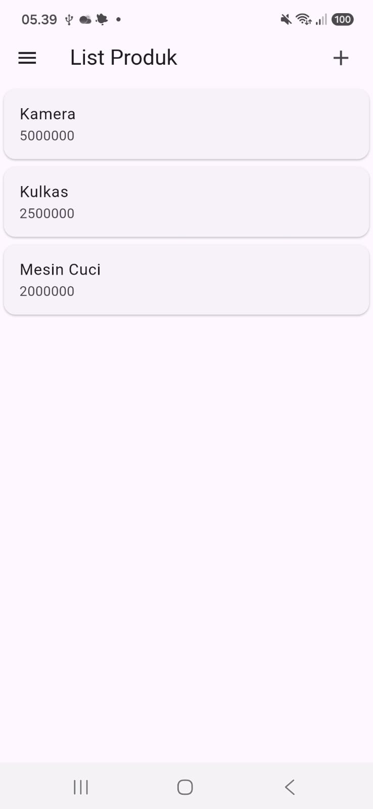
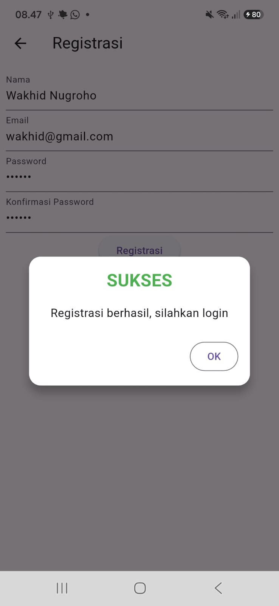
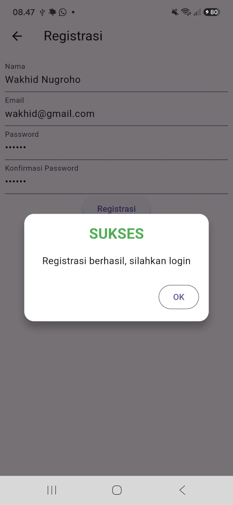

# Laporan Praktikum Pemrograman Mobile

**Nama**        : Wakhid Nugroho  
**NIM**         : H1D024003  
**Shift**       : Awal H / Akhir C  
**Praktikum**   : Pemrograman Mobile

---

📝 Tugas 1

Tanggal: Selasa, 10 November 2026

Dokumentasi Praktikum

  

  

  

  

Kesimpulan Praktikum:

Pada pertemuan pertama, praktikum berfokus pada pembuatan aplikasi TokoKita menggunakan Flutter. Praktikan mempelajari pembuatan struktur project, model data Login, Registrasi, dan Produk, serta implementasi antarmuka halaman Registrasi dan Login. Selain itu, praktikan juga membuat Form Produk untuk menambahkan dan mengubah data, halaman Detail Produk untuk menampilkan informasi serta menyediakan fitur EDIT dan DELETE, dan halaman List Produk untuk menampilkan daftar produk. Praktikan juga mempelajari navigasi antarhalaman serta pengaturan main.dart sebagai entry point aplikasi.

Praktikum ini memberikan pemahaman mengenai dasar pengembangan aplikasi mobile menggunakan Flutter, khususnya dalam penyusunan struktur project, pembuatan model data, pembuatan antarmuka, dan navigasi antarhalaman.

## 📝 Tugas 2
**Tanggal**: Selasa, 17 November 2026

### 📸 Dokumentasi Praktikum

  

  

### 📌 Kesimpulan Praktikum

Berdasarkan pelaksanaan praktikum lanjutan CRUD yang mengacu pada modul **`5_CRUD_Module_Flutter_2.pdf`**, dapat diambil beberapa kesimpulan sebagai berikut:

1. **Pembuatan Helper dan Modul Pendukung (`lib/helpers/`)**:
   - Berhasil mengimplementasikan `UserInfo` dengan memanfaatkan package `shared_preferences` untuk menyimpan token autentikasi, menyimpan dan mengambil `userID`, serta mengelola proses logout dengan membersihkan sesi penyimpanan lokal.
   - Mengimplementasikan `AppException` dan turunan-turunannya (`FetchDataException`, `BadRequestException`, `UnauthorisedException`, `InvalidInputException`) sebagai penanganan kesalahan (*error handling*) komunikasi jaringan secara terstruktur.
   - Mengimplementasikan modul HTTP request `Api` (`GET`, `POST`, `PUT`, `DELETE`) menggunakan package `http` yang secara otomatis menyertakan header Bearer Token pada setiap permintaan yang membutuhkan autentikasi.
   - Mengonfigurasi `ApiUrl` untuk mendefinisikan Base URL dan rute endpoint REST API CodeIgniter 4 (`/registrasi`, `/login`, `/produk`, serta endpoint dinamis untuk detail, update, dan delete produk).

2. **Pengelolaan Arsitektur BLoC (`lib/bloc/`)**:
   - Membangun `RegistrasiBloc` untuk menangani transmisi data pendaftaran pengguna ke API dan mengonversi respons JSON menjadi model `Registrasi`.
   - Membangun `LoginBloc` untuk mengirimkan kredensial email dan password serta memetakan respons JSON ke model `Login`.
   - Membangun `LogoutBloc` untuk mengosongkan token dan informasi sesi pengguna.
   - Membangun `ProdukBloc` untuk mengelola operasi CRUD produk secara menyeluruh terhadap REST API: pengambilan data (`getProduks`), penambahan (`addProduk`), pembaruan (`updateProduk` via HTTP PUT), dan penghapusan (`deleteProduk` via HTTP DELETE).

3. **Penyediaan Reusable Common Dialogs (`lib/widget/`)**:
   - Mengimplementasikan `SuccessDialog` dan `WarningDialog` sebagai komponen dialog standar untuk memberikan umpan balik visual kepada pengguna ketika suatu operasi (registrasi, login, simpan, ubah, atau hapus) berhasil maupun gagal.

4. **Pemeriksaan Sesi Otomatis pada `main.dart`**:
   - Memodifikasi `main.dart` agar secara asinkron memeriksa keberadaan token login melalui `UserInfo.getToken()`. Jika token ditemukan, aplikasi langsung membuka `ProdukPage`; jika tidak ditemukan, aplikasi mengarahkan pengguna ke `LoginPage`.

5. **Integrasi Antarmuka Halaman dengan REST API**:
   - **Halaman Registrasi (`registrasi_page.dart`)**: Form input divalidasi dan terhubung dengan `RegistrasiBloc.registrasi()`. Muncul `SuccessDialog` saat pendaftaran berhasil dan `WarningDialog` jika terjadi kesalahan.
   - **Halaman Login (`login_page.dart`)**: Form login terhubung dengan `LoginBloc.login()`. Token autentikasi dan user ID disimpan ke `SharedPreferences`, lalu pengguna dialihkan ke `ProdukPage`.
   - **Halaman List Produk (`produk_page.dart`)**: Daftar produk statis diganti dengan `FutureBuilder` yang memanggil `ProdukBloc.getProduks()` untuk mengambil dan merender data produk secara dinamis dari database melalui REST API. Menu logout pada Drawer terintegrasi dengan `LogoutBloc` dan mengarahkan kembali ke `LoginPage`.
   - **Halaman Form Produk (`produk_form.dart`)**: Terhubung dengan `ProdukBloc.addProduk()` untuk mode penambahan produk baru dan `ProdukBloc.updateProduk()` untuk mode pembaruan produk.
   - **Halaman Detail Produk (`produk_detail.dart`)**: Menampilkan detail data produk serta mengoreksi implementasi tombol `Ya` pada dialog konfirmasi hapus agar secara tepat mengeksekusi `ProdukBloc.deleteProduk(id)` ke REST API.
