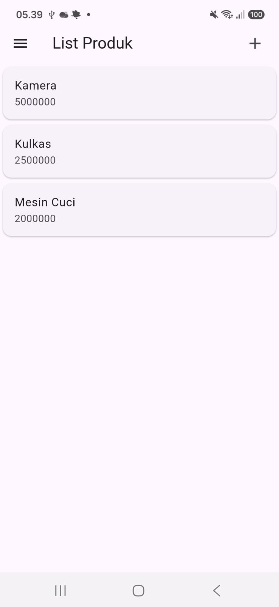
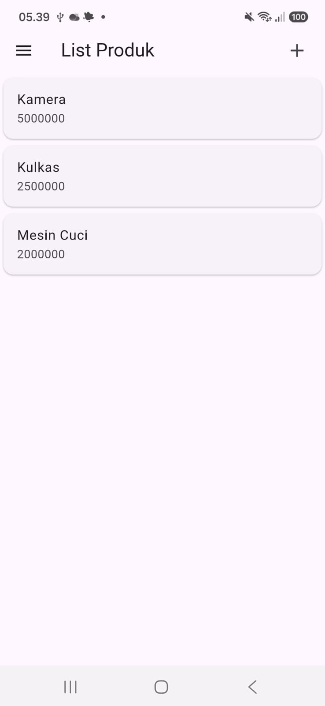
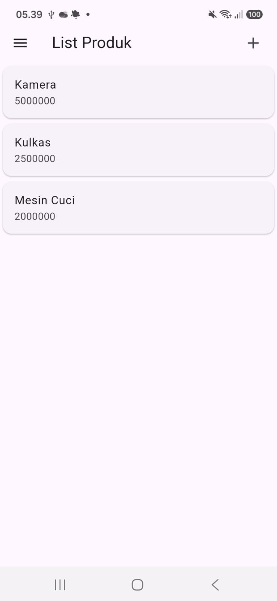

# Laporan Praktikum Pemrograman Mobile

**Nama**        : Wakhid Nugroho  
**NIM**         : H1D024003  
**Shift**       : Awal H / Akhir C  
**Praktikum**   : Pemrograman Mobile

---

## 📝 Tugas Pertemuan 1
**Tanggal**: Selasa, 10 November 2026

### 📸 Dokumentasi Praktikum

Berikut adalah hasil dokumentasi tampilan aplikasi Flutter TokoKita yang berhasil dijalankan pada perangkat mobile Android:

  

  

  

  

---

### 📌 Kesimpulan Praktikum

1. **Pembuatan Project Flutter TokoKita**: Berhasil menginisialisasi dan menyusun struktur project Flutter bernama TokoKita yang rapi dan terorganisir sesuai standar arsitektur Flutter.
2. **Pembuatan Model Data**: Berhasil mengimplementasikan model data Dart pada folder `lib/model/`, yaitu model `Login`, `Registrasi`, dan `Produk`. Masing-masing model dilengkapi dengan atribut yang sesuai, constructor, serta factory method `fromJson` untuk keperluan pemetaan data JSON.
3. **Pembuatan Halaman Registrasi dan Login**: Berhasil membangun antarmuka halaman `RegistrasiPage` dan `LoginPage` pada folder `lib/ui/` lengkap dengan `FormState`, controller `TextEditingController`, validasi input formulir (panjang karakter nama dan password, validasi format regex email, serta pencocokan konfirmasi password), dan navigasi perpindahan antarhalaman.
4. **Pembuatan Form Produk**: Berhasil membuat widget `ProdukForm` yang memiliki kapabilitas ganda, yaitu untuk menambah produk baru serta mengubah data produk yang sudah ada secara otomatis (*pre-filled form*) saat objek produk dikirimkan melalui parameter (`isUpdate`).
5. **Pembuatan Halaman Detail Produk**: Berhasil membuat widget `ProdukDetail` untuk menyajikan informasi lengkap suatu produk (kode produk, nama produk, dan harga), serta menyediakan tombol aksi `EDIT` (mengarahkan kembali ke `ProdukForm`) dan `DELETE` yang dilengkapi dialog konfirmasi penghapusan (`AlertDialog`).
6. **Pembuatan Halaman List Produk**: Berhasil membangun halaman utama `ProdukPage` yang memuat AppBar dengan tombol tambah produk (`+`), Drawer navigasi yang menyediakan menu `Logout`, serta daftar item produk yang dapat diklik untuk membuka halaman detail.
7. **Pengaturan Entry Point Aplikasi**: Berhasil mengatur `lib/main.dart` sebagai titik masuk (*entry point*) utama aplikasi menggunakan `MaterialApp`, menonaktifkan banner debug, dan menetapkan `ProdukPage` sebagai halaman awal (*home*).
